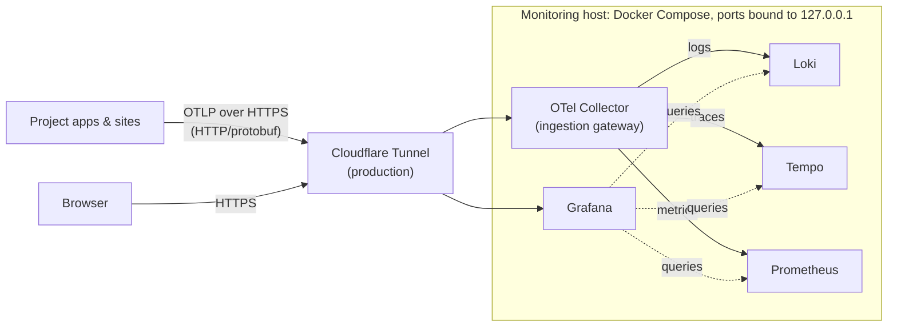
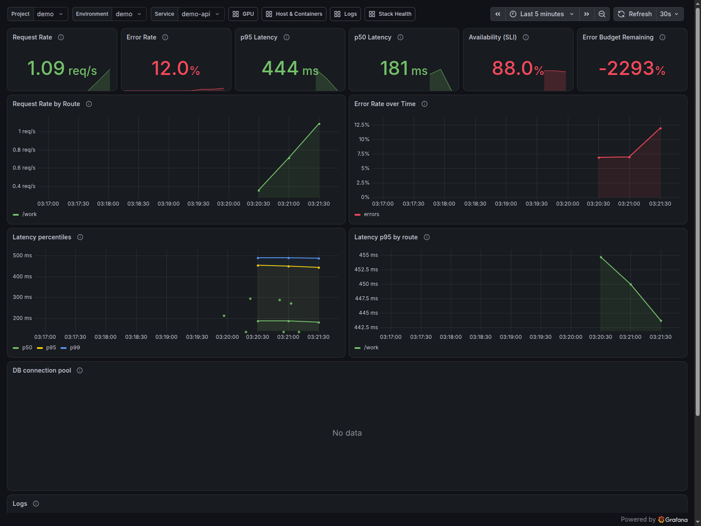

# Observability stack

[](https://github.com/CMLPlatform/monitoring/actions/workflows/ci.yml)
[](https://scorecard.dev/viewer/?uri=github.com/CMLPlatform/monitoring)
[](config/otel-collector.yaml)
[](compose.yml)
[](LICENSE)

Central monitoring for CML research software. A single host runs Grafana, Loki,
Tempo, Prometheus, and an OpenTelemetry Collector. Research applications send
metrics, traces, and logs over standard OTLP (OpenTelemetry protocol), and Grafana
displays them side by side.

## Who reports here

| Project | Environment | Telemetry | Host | Spoke overlay |
| --- | --- | --- | --- | --- |
| [R9lab](https://github.com/CMLPlatform/relab) | `r9lab/prod` | Logs, Traces, Metrics | CML VM | `templates/spoke/host/compose.telemetry.yml` |
| [R9lab](https://github.com/CMLPlatform/relab) | `r9lab/staging` | Logs, Traces, Metrics | CML VM | `templates/spoke/host/compose.telemetry.yml` |
| [CML Gallery](https://github.com/CMLPlatform/cml-gallery) | Planned | Probes, RUM | GitHub Pages | `templates/web/rum.html` |

The alert marker in `config/grafana/alerting/projects.yaml` guards active reporting.
The `ProjectsUncovered` rule fires if an unlisted spoke begins transmitting.

## Connect your project

Connecting a service takes about five minutes without application code changes.
See [docs/ONBOARDING.md](docs/ONBOARDING.md) for step-by-step recipes:

1. **Web services (FastAPI/Python):** Add standard OTel environment variables to emit traces, RED metrics, and correlated logs.
2. **Static websites and portals:** Register an outside-in uptime probe (`just probe-add`) or drop in the browser Real User Monitoring snippet ([`templates/web/rum.html`](templates/web/rum.html)) for Core Web Vitals.
3. **Project hosts and VMs:** Run `./bootstrap.sh <project> <env>` to deploy a Grafana Alloy agent for container logs and host resources.

## Architecture



The stack operates on a hub-and-spoke model:

- **Single gateway:** Everything enters through the OpenTelemetry Collector on one port.
- **Unified alerting:** Grafana evaluates all alert rules across both metrics and logs. No separate Alertmanager daemon.
- **Outside-in detection:** External probers and dead-man's switches are the only alarms whose default state is firing. Silence indicates failure, not health.

Architecture decisions and trade-offs are documented in [ADR 0001 (Stack Selection)](docs/adr/0001-observability-stack.md) and [ADR 0002 (Hub-and-Spoke Design)](docs/adr/0002-hub-and-spoke-observability.md).

## Try it in one command

Prerequisites: Docker with [Compose plugin](https://docs.docker.com/compose/install/) and [`just`](https://github.com/casey/just#installation).

```sh
cp .env.example .env
just demo
```

This launches the core monitoring stack and a demo FastAPI service under simulated load on port 3002:

- Open Grafana at <http://localhost:3002> (`admin` / `change-me`).
- View **Dashboards → Service Health (RED)** for request rates, error rates, and latency traces.
- Stop and clean up: `just demo-destroy`.



## Operating the stack

Host deployment, secret rotation, pre-flight environment checks, alert matrices, and backups are documented in [docs/RUNBOOK.md](docs/RUNBOOK.md).

In production, run:

```sh
# Set COMPOSE_FILE=compose.yml:compose.tunnel.yml in .env
just up
just check
```

## Documentation

| Document | Purpose |
| --- | --- |
| [docs/ONBOARDING.md](docs/ONBOARDING.md) | Connect applications, static sites, and browser frontends |
| [templates/README.md](templates/README.md) | Deploy host agent (Grafana Alloy) for host metrics and container logs |
| [docs/RUNBOOK.md](docs/RUNBOOK.md) | Host operations, pre-flight guards, alerts, and troubleshooting |
| [docs/adr/](docs/adr/) | Architectural Decision Records (ADR 0001, ADR 0002) |
| [CHANGELOG.md](CHANGELOG.md) | Release history and upgrade notes |
| [CONTRIBUTING.md](.github/CONTRIBUTING.md) | Contribution workflow, conventions, and checks |
| [SECURITY.md](.github/SECURITY.md) | Security policy and vulnerability disclosure |

Licensed under the [MIT License](LICENSE). To cite the stack, see [CITATION.cff](CITATION.cff).
