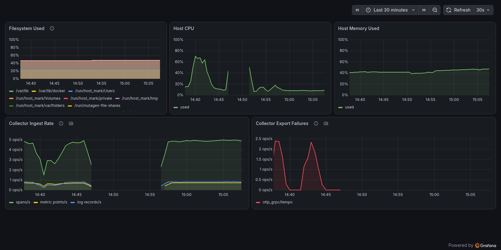

# Runbook

All commands run from the repo root on the monitoring host. Start with
`docker compose ps` and the **Stack Health** dashboard. Between them they answer most
"what is wrong" questions.



In that capture, the red export-failure spike is a Tempo outage and the gap in
the ingest panel is a backup/restore drill.

## A service is down or misbehaving

```sh
docker compose ps                 # what's running, what's restarting
docker compose logs -f <service>  # follow logs (otel-collector, loki, tempo, prometheus, grafana)
just restart <service>
```

Two alerts point here. `TargetDown` fires after two minutes when Prometheus
cannot scrape a service. It scrapes every service, so the alert names the one
that went quiet. `OtelExportFailures` means the collector is up but a backend
is rejecting its data. Read that backend's logs, not the collector's.

## Disk filling up (`HostDiskSpaceLow`)

Retention is only partially size-bounded:

| Data | Time limit | Size limit |
| --- | --- | --- |
| Container stdout logs | none | json-file 10m × 3 per service |
| Prometheus TSDB | 30d | 15GB (`--storage.tsdb.retention.size`) |
| Loki chunks | 30d | none |
| Tempo blocks | 7d | none |

Loki and Tempo cannot cap their total size, so the disk alert at 80% is the
backstop. Two warnings fire earlier. `HostDiskFilling` means a 6-hour linear
fit says a filesystem is full within 3 days. `PrometheusCardinalityHigh`
means active series passed 30k, about 4x the baseline of ~7k with one spoke,
which is roughly 18 spokes of room at ~1,400 series each.
`PrometheusCardinalitySpike` means 5,000 series appeared in 30 minutes, far
faster than onboarding explains, so a label has most likely exploded. Series
count, not time, is what grows the TSDB.

When one fires:

1. Check the Filesystem panel on Stack Health.
2. Free space, or shorten a retention window and restart the service:
   `retention_period` in `config/loki.yaml`, `block_retention` in
   `config/tempo.yaml`, or the `--storage.tsdb.retention.*` flags in
   `compose.yml`.
3. If disk pressure keeps returning, move Loki and Tempo to object storage.
   The appendix of ADR 0001 describes the change.

Memory is bounded per service: every service has a `mem_limit` in
`compose.yml`, sized from observed usage. Raise it there if a component
legitimately grows into its ceiling.

## Alert reference

All alerts evaluate in Grafana (`config/grafana/alerting/`) and deliver to
`ALERT_WEBHOOK_URL` (with `Watchdog` pinging `HEARTBEAT_URL`):

| Alert | Severity | Trigger condition | Triage action |
| --- | --- | --- | --- |
| `Watchdog` | none | Fires permanently | Dead-man's switch heartbeat. If external pings stop, the host or Grafana is down. |
| `AlertDeliveryFailing` | critical | Grafana cannot deliver alerts for 10m | Check webhook URL connectivity and webhook receiver logs. |
| `TargetDown` | critical | Prometheus cannot scrape an internal service for 2m | Run `docker compose ps` and `docker compose logs <service>`. |
| `OtelExportFailures` | warning | Collector dropping/failing exports for 5m | Check downstream receiver logs (Loki, Tempo, Prometheus); check disk/memory. |
| `ProjectTelemetrySilent` | critical | Onboarded spoke stopped sending telemetry for 15m | Inspect spoke agent/host; check Cloudflare tunnel or network connectivity. |
| `ProjectsUncovered` | warning | A project is sending telemetry but missing from `projects.yaml` | Add the project/environment to `config/grafana/alerting/projects.yaml`. |
| `ContainerRestarting` | warning | Spoke or hub container restarted > 3 times in 1h | Check container crashloop logs (`docker logs --tail 100 <container>`). |
| `ContainerOOMKilled` | warning | Container killed by Linux kernel OOM killer | Check container memory ceiling in compose file or spoke allocation. |
| `HighErrorRate` | warning | Application HTTP 5xx error rate > 5% for 5m | Inspect service RED dashboard, drill into error logs and Tempo traces. |
| `HighLatencyP99` | warning | Application p99 latency > 2s for 5m | Check DB connection pool usage, slow routes on RED dashboard, and trace spans. |
| `HostDiskSpaceLow` | warning | Host disk usage > 80% for 15m | Free space, prune docker images, or shorten retention in Loki/Tempo. |
| `HostDiskFilling` | warning | Linear forecast predicts disk full within 3 days | Check for runaway log generation or Prometheus metric cardinality explosion. |
| `HostMemoryHigh` | warning | Host RAM usage > 90% for 15m | Check container working sets on Host & Containers dashboard. |
| `PrometheusCardinalityHigh` | warning | Active timeseries > 30,000 for 30m | Inspect label explosion using Prometheus TSDB status API. |
| `PrometheusCardinalitySpike` | warning | > 5,000 new timeseries within 30m | High churn in metric labels; identify which service introduced non-cardinal labels. |

## Backup and restore

```sh
just backup                # pauses stateful services for seconds, writes backups/monitoring-<ts>.tar.gz
just restore backups/monitoring-<ts>.tar.gz   # stops the stack, wipes volumes, restores
just up
```

Backups are crash-consistent. Restoring one is like recovering from a power
loss, which every component handles through its write-ahead log.

- The tarball is mode 0600 and contains secrets, including the Grafana
  database. Copy it off-host over a private channel.
- `just restore` refuses to run if the stack's volumes do not exist yet. On a
  fresh host, run `just up` once to create them, then restore.
- It covers the docker volumes only. The OpenTofu state for the Cloudflare
  edge is not in it. See "Where every secret lives" below.
- During the pause the collector buffers incoming telemetry for five minutes
  (`retry_on_failure.max_elapsed_time` in `config/otel-collector.yaml`). A
  backup that runs longer drops data. On large volumes, run it at a quiet
  hour.

Worst-case loss equals the interval between backups. Run it from a daily cron
on the host.

## Rotating secrets

- **OTLP token:** set the new `OTLP_AUTH_TOKEN` in `.env`, run
  `docker compose up -d otel-collector`, then update every sender's
  `OTEL_EXPORTER_OTLP_HEADERS`. Senders on the old token get 401s until
  updated. A running demo overlay is a sender too: re-run `just demo`.
  The token is shared, and the collector does not check `project` or `env`
  against the sender. Every project host can therefore spoof another
  project's labels.

  Bearer is the only scheme the collector accepts. A sender that cannot set a
  raw `Authorization` header ships through the host's Alloy agent instead.
- **Tunnel token:** rotate the tunnel secret in Cloudflare Zero Trust, then
  run `cd infra && tofu apply` to refresh the token data source, then read
  the new value with `tofu output -raw tunnel_token`. To rotate from code
  instead, run `tofu apply -replace=cloudflare_zero_trust_tunnel_cloudflared.monitoring`.
  That builds a new tunnel and repoints both CNAMEs at it, and ingestion and
  Grafana are unreachable for about a minute. Either way, put the new token
  in `CLOUDFLARE_TUNNEL_TOKEN` in `.env`, then `just up`.
- **Grafana admin password:** change `GRAFANA_ADMIN_PASSWORD` in `.env`,
  then `docker compose up -d grafana`.
- **Alert webhook and heartbeat URLs:** the URL is the credential. Mint a new
  topic or check at the provider, put it in `ALERT_WEBHOOK_URL` or
  `HEARTBEAT_URL`, then `docker compose up -d grafana`. Grafana reads the
  contact points only at startup.
- **healthchecks.io API key:** regenerate it in the project's settings and
  set `HEALTHCHECKS_API_KEY` in `.env`. Only `bootstrap.sh` reads it, so
  nothing restarts.
- **Cloudflare API token:** it is never stored here. Create a new one with
  the same three permissions, revoke the old one, and export the new value
  before the next `tofu` run.

### Where every secret lives

Three gitignored files hold everything. `just backup` archives none of them,
but the tarball contains Grafana's database, and Grafana stores the expanded
contact points there. So the webhook and heartbeat URLs are inside every
backup. Copy `.env` and `infra/terraform.tfstate` off-host together with the
backups and treat all three the same way.

| Secret | Lives in | Comes from |
| --- | --- | --- |
| `OTLP_AUTH_TOKEN` | `.env` | `openssl rand -hex 32` |
| `GRAFANA_ADMIN_PASSWORD` | `.env` | you |
| `ALERT_WEBHOOK_URL`, `HEARTBEAT_URL` | `.env` | the notification provider |
| `HEALTHCHECKS_API_KEY` | `.env` | healthchecks.io project settings |
| `CLOUDFLARE_TUNNEL_TOKEN` | `.env` | `tofu output -raw tunnel_token` |
| `NTFY_BASE_URL` | `.env` (optional) | public ntfy hostname, e.g. `https://ntfy.example.com` |
| `CF_ACCESS_AUD` | `.env` (not secret, but paired) | `tofu output -raw grafana_access_aud` |
| Tunnel secret, API responses | `infra/terraform.tfstate` | written by every `tofu apply` |
| `CLOUDFLARE_API_TOKEN` | your shell, per session | Cloudflare dashboard |

`infra/terraform.tfvars` holds identifiers only (account, zone, domain, the
Access email list). It is gitignored for privacy, not because it holds a
credential.

## Alert catalog

Eighteen alert rules guard the stack and reporting spokes across six folders.
The PromQL threshold evaluates instant expressions; a rule fires when its
comparison stays true for the duration of `for`:

| Rule | Group | Severity | For | Trigger & Intent |
| --- | --- | --- | --- | --- |
| `Watchdog` | meta | none | 0m | Heartbeat pinging dead man's switch (`vector(1)`); always firing. |
| `AlertDeliveryFailing` | meta | critical | 10m | Grafana failing to deliver webhook notifications. |
| `TargetDown` | stack-health | critical | 2m | Prometheus cannot scrape an internal job target (`up == 0`). |
| `OtelExportFailures` | stack-health | warning | 5m | OTel Collector failing to export spans, metrics, or logs. |
| `BlackboxProbeFailed` | service-red | critical | 2m | Outside-in HTTP probe failed for an endpoint (`probe_success == 0`). |
| `ErrorBudgetBurnFast` | service-red | critical | 2m | 14.4x burn rate (2% of 30d 99.5% SLO consumed in 1h; short 5m + long 1h). |
| `ErrorBudgetBurnSlow` | service-red | warning | 15m | 6x burn rate (5% of 30d 99.5% SLO consumed in 6h; short 30m + long 6h). |
| `HighErrorRate` | service-red | warning | 5m | Over 5% 5xx HTTP response codes on a service over 5 minutes. |
| `HighLatencyP99` | service-red | warning | 5m | Slowest 1% of requests exceed 2 seconds over 5 minutes. |
| `HostDiskSpaceLow` | capacity | warning | 15m | Storage volume under 20% free space. |
| `HostDiskFilling` | capacity | warning | 30m | Linear fit predicts volume exhaust within 3 days. |
| `HostMemoryHigh` | capacity | warning | 15m | Host RAM over 90% utilized for 15 minutes. |
| `PrometheusCardinalityHigh` | capacity | warning | 30m | Active series exceed 30,000 threshold (~18 spokes baseline). |
| `PrometheusCardinalitySpike` | capacity | warning | 15m | Head series spike by >5,000 in 30 minutes. |
| `ContainerRestarting` | container-lifecycle | warning | 10m | Container restarts >3 times within 1 hour. |
| `ContainerOOMKilled` | container-lifecycle | warning | 0m | Container terminated by host kernel OOM killer. |
| `ProjectTelemetrySilent` | spoke | warning | 15m | Spoke service stopped shipping OTel telemetry. |
| `ProjectUnscheduledRestart` | spoke | warning | 5m | Spoke container restarted unexpectedly. |

## Alert delivery

Grafana evaluates and delivers the rules. Rules, contact points, and the
routing tree are provisioned from `config/grafana/alerting/`, so the UI shows
them read-only. Edit the YAML.

- `ALERT_WEBHOOK_URL` receives all alerts.
- `HEARTBEAT_URL` receives the always-firing `Watchdog` every five minutes.
  Point it at a dead man's switch that raises the alarm when pings stop.

Leaving either empty is not safe. Delivery fails silently while the heartbeat
keeps pinging, so the switch reads healthy and every real alert is dropped.
With the tunnel overlay active, `just up` refuses to start without
`ALERT_WEBHOOK_URL`, and `AlertDeliveryFailing` fires on a failing notifier.

After changing either variable, run `docker compose up -d grafana`. A plain
`restart` keeps the old environment. Compose rebuilds a container's
environment only on `up`.

### Self-hosted alert delivery with ntfy

Alert bodies carry infrastructure detail — hostnames, mount points, job names,
and environment tags. A public hosted push service where topic names are the
only protection allows anyone who discovers the topic to eavesdrop or forge
alerts.

The monitoring stack includes a self-hosted `ntfy` service running behind
Cloudflare Tunnel with strict zero-trust authentication (`auth-default-access: "deny-all"`):

```text
+------------------------------------------------------------------+
| Monitoring Host                                                  |
|                                                                  |
|   Grafana ------(http://ntfy:80/alerts?tpl=1...)------> ntfy     |
|   (publisher)                                            |       |
|                                                     [auth.db]    |
|                                                          ^       |
|                                                          |       |
|   cloudflared <---(https://ntfy.example.com)-------------+       |
|   (tunnel)                                                       |
+-------^----------------------------------------------------------+
        |
   Mobile / Web client (authenticated subscriber)
```

#### 1. Create the Grafana publisher user

Generate a password and add the user inside the container:

```sh
docker compose exec -e NTFY_PASSWORD="<grafana-secret>" ntfy ntfy user add grafana
docker compose exec ntfy ntfy access grafana alerts write-only
```

#### 2. Configure Grafana contact point

Point `ALERT_WEBHOOK_URL` in `.env` to the local ntfy instance using native
message templating (`?tpl=1`):

```sh
ALERT_WEBHOOK_URL=http://grafana:<grafana-secret>@ntfy:80/alerts?tpl=1&title={{.CommonAnnotations.summary}}&message={{.CommonAnnotations.description}}
```

Apply the change to Grafana:

```sh
docker compose up -d grafana
```

#### 3. Create subscriber users for operators

Each team member gets their own account with read-only access to the alerts topic:

```sh
docker compose exec -e NTFY_PASSWORD="<user-secret>" ntfy ntfy user add simon
docker compose exec ntfy ntfy access simon alerts read-only
```

#### 4. Subscribe from phone or desktop

Operators subscribe to `https://ntfy.<domain>/alerts` using the ntfy mobile app
(iOS / Android) or web UI, authenticating with their username and password.
Do NOT put the ntfy domain behind Cloudflare Access SSO: mobile push clients
cannot complete the browser-based OAuth flow, breaking notifications silently.
ntfy's internal credentials over TLS provide the access boundary.

## Changing the Cloudflare edge

The tunnel, its ingress rules, both DNS records, and the Access policy in
front of Grafana are all OpenTofu in `infra/`. Change them there, not in the
Zero Trust dashboard. The next apply reverts anything clicked in by hand.

```sh
just infra-validate                 # tofu init + validate, in a container
cd infra && tofu plan               # needs CLOUDFLARE_API_TOKEN exported
cd infra && tofu apply
```

- **Granting or revoking Grafana access:** edit `grafana_allowed_emails` in
  `infra/terraform.tfvars` and apply. That list is the entire allowlist. A
  removed address keeps working until its Access session expires (24h). For
  an urgent revocation, also revoke the session in Zero Trust. The variable
  rejects an empty list, which would lock everyone out. Before adding people,
  check your plan's Zero Trust seat limit in the Cloudflare dashboard.
- **Per-user Grafana logins:** by default everyone who clears Access shares
  the admin password. Set `GRAFANA_JWT_AUTH=true`,
  `CF_ACCESS_TEAM_DOMAIN=<team>`, and `CF_ACCESS_AUD` (from
  `tofu output -raw grafana_access_aud`) in `.env`. Grafana then verifies
  the Access JWT, and each address signs in as itself with the Viewer role.
  The aud pin is required. The JWK set is team-wide, so without it a token
  minted for any other Access app in the team would be accepted here.
- **Adding a hostname:** add an `ingress` entry pointing at the service's
  container port, plus a matching `cloudflare_dns_record`. The catch-all
  `http_status:404` entry stays last, or it swallows everything after it.
- **First apply against an edge built by hand:** an empty state plans the
  existing tunnel, DNS records, and Access app as "create", and applying
  that mints duplicates. Run `infra/generate-imports.sh > infra/imports.tf`
  first, check the plan reads 0 to add for the imported resources, apply,
  then delete `imports.tf`.
- **State lives on this host only, and it is a secret.** It stores the
  tunnel secret and every API response in plain text. Copy
  `infra/terraform.tfstate` off-host next to the backups. Losing it orphans
  the Cloudflare resources: they keep running, but the next apply creates
  duplicates. Recovery is the same import path as the first apply above,
  `infra/generate-imports.sh > infra/imports.tf`, which reads the live objects
  back out of the Cloudflare API and adopts them into a fresh state.

## Cutting a release

A tag is the deployable unit: `bootstrap.sh` pins every spoke's vendored
templates to the latest tag, and refuses to run without one.

1. Add a `## [x.y.z] - date` section to `CHANGELOG.md` and merge it. Put
   anything a spoke must do (re-vendor templates, change a variable) under
   an `Upgrade` heading.
2. Tag and push:

   ```sh
   git tag vx.y.z && git push origin vx.y.z
   ```

   The release workflow runs `just check` and publishes the GitHub release
   with that changelog section as its body. No section, no release: the tag
   stays, so fix the changelog on `main` and re-tag.
3. Deploy the hub (below), then run `./bootstrap.sh <project> <env>` for each
   spoke and follow what it prints. The checksums it emits are for the new
   tag.

## Upgrading images

Dependabot opens PRs that bump the pinned versions, and CI runs `just validate`
and `just smoke` on each one. The validators read their image versions from
`compose.yml`, so every bump is checked with the exact binaries the stack
will run. Patch bumps arrive grouped. A minor or major comes on its own, so a
red PR names the one image that broke.

Dependabot also watches the Cloudflare provider in `infra/`. Those PRs need
one manual step: it bumps the constraint in `main.tf` but not the hashes in
`.terraform.lock.hcl`. Check the branch out, run `cd infra && tofu init
-upgrade`, then `just infra-validate` and `tofu plan` against the real
account. Only a plan proves the provider still maps the config to the same
resources.

Nothing watches the tool images pinned in the `justfile` (yamllint,
actionlint, shellcheck, ruff, gitleaks, OpenTofu, jq). Bump those by hand.
The backup recipes reuse the alpine image of `otel-queue-init` in
`compose.yml`.

After merging, on the host:

```sh
git pull && docker compose pull && just up
```

`just up` adds the exposure guards, but a plain `docker compose up -d` is now
safe too: the `otel-queue-init` service chowns the collector's queue volume to
uid 10001 before the collector starts.
